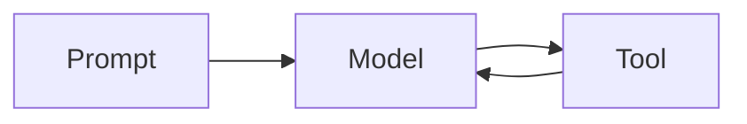

> [!margin] Margin notes sit beside the text on wide screens and fold into it on a phone.

This is a sample note. An agent can look mysterious from the outside, but much of its behavior comes from a simple loop. I'm linking to [[Thinking in Systems]] and to [[a note that was never published]], which stays plain text.

> The interesting decisions live in what the model gets to see.

## The smallest possible loop

```python
while True:
    reply = model(messages)
    if reply.tool_call is None:
        return reply.text
    messages.append(run_tool(reply.tool_call))
```

> [!note]
> Callouts look like this.

> [!under]
> An optional deep dive. At each step, $a_t \sim p(a \mid h_t)$.

$$
a_t \sim p(a \mid h_t)
$$


